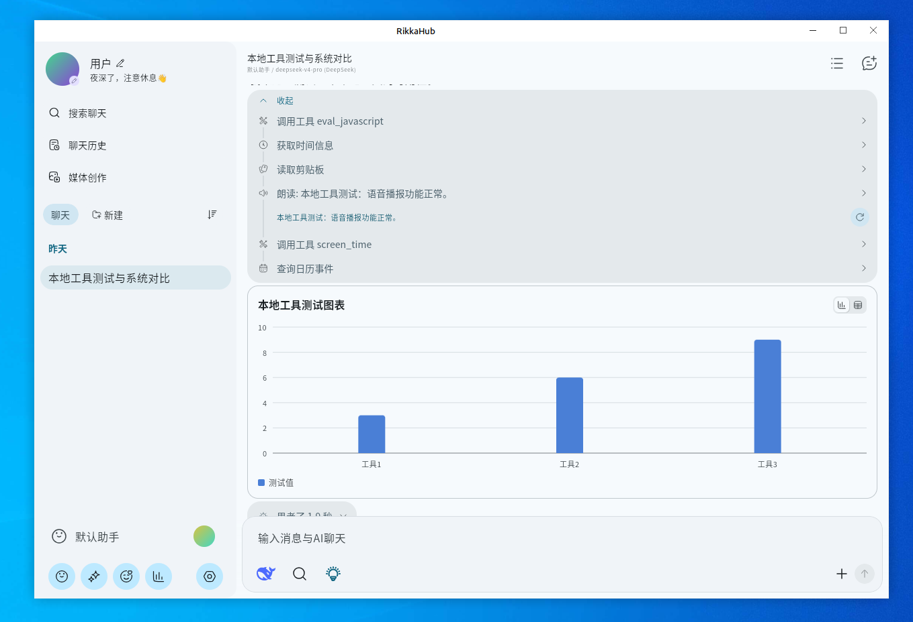

这个分支专注于Linux的适配。不定时rebase
<div align="center">
  
</div>

## 构建入口

Android 与 Linux 使用独立的 Gradle 项目，复用仓库的 Gradle Wrapper 和版本目录。

```bash
# Android：原有模块、构建任务和工作流
./gradlew assembleGithubDebug

# Linux：不配置 Android 模块，也不要求 Android SDK
./gradlew -p linux test
./gradlew -p linux run
./gradlew -p linux packageDistributionForCurrentOS
```

Linux 直接编译上游共享源码；平台适配和生成规则保留在 `linux/`。Android 构建不会加载 Linux 插件或下载桌面 JBR。

Linux 构建需要 JDK 21、CMake 3.19+ 和 C++ 编译器（Debian/Ubuntu：`apt install cmake g++`）。
运行和打包任务会自动选用 JBR 21；测试和项目配置使用构建机的 JDK。
`.github/workflows/linux-build.yml` 独立验证 Linux，原 Android 工作流保持原入口。

## 上游兼容

- 数据库 schema 和全部迁移直接复用 `app`，Linux KSP 的输出写入 `linux/build/roomSchemas`。
- 全文检索复用上游 SQL、增量索引和查询构造，使用同版本的 `simple v0.6.1` 扩展（关闭 jieba）。
  本地编译的扩展随应用打包，无需运行时下载；旧 Linux 预分词索引首次打开时从消息原文重建。
- 备份管理器复用上游源码，ZIP 条目、WAL 合并、暂存校验和重启恢复流程保持一致。
  Linux 数据库仍使用既有的 `database/database` 路径，备份条目仍为 `rikka_hub.db`。
- `linux/gradle/source-compat.gradle.kts` 统一登记源码改写，由同一声明派生原文件排除项、生成输入和匹配校验。
  完整的平台替身在 `linux/src/platform` 中独立维护。

验证：`./gradlew -p linux test`。迁移、索引和恢复测试均使用临时目录。
应用目录构建：`./gradlew -p linux createDistributable`，产物位于 `linux/build/compose/binaries/main/app/RikkaHub`。
