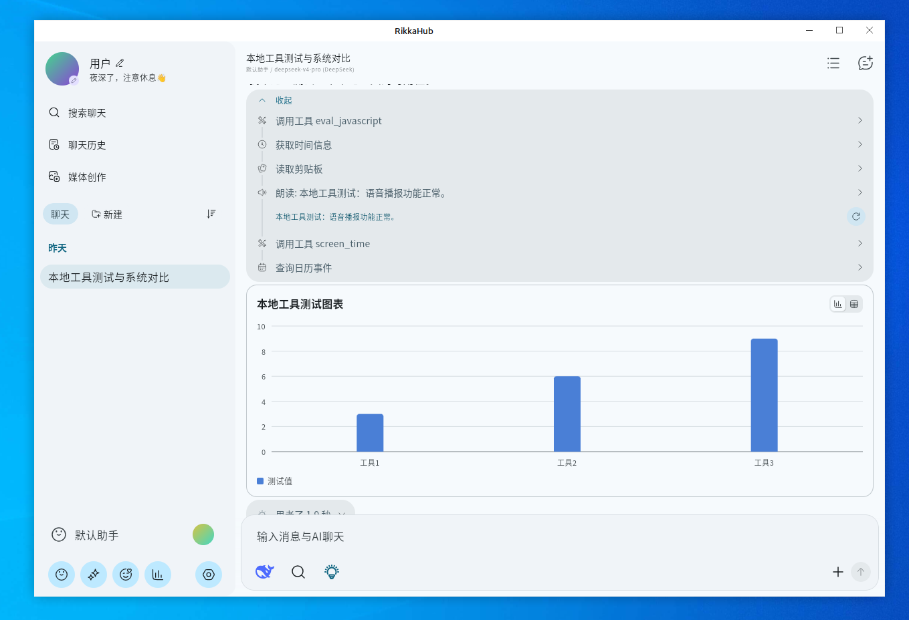

  
  <h1>RikkaHub MultiPlatform</h1>

这个分叉专注于Linux、Windows、OpenHarmony的AOT适配。
基础UI已经可用，但仍有大量功能需要移植。

> [!WARNING]
> 此分叉不添加新功能！提issue请确保是分叉问题。不定时rebase。\
> This fork does not add new features! When filing an issue, please make sure it is a fork-specific issue.

  

## 如何构建

条件: 装了graalvm25

1. 运行`./linux/aot/build.sh`
2. 在`./linux/build/output`里找到产物

不建议用upx压缩，因为内存占用会多50M

## 改了什么

1. 修改了一些逻辑以优化CPU占用
2. 添加stub和shim 让基础ui能用

## 📄 License

This project is licensed under the [GNU Affero General Public License v3.0](LICENSE) (AGPL-3.0).
